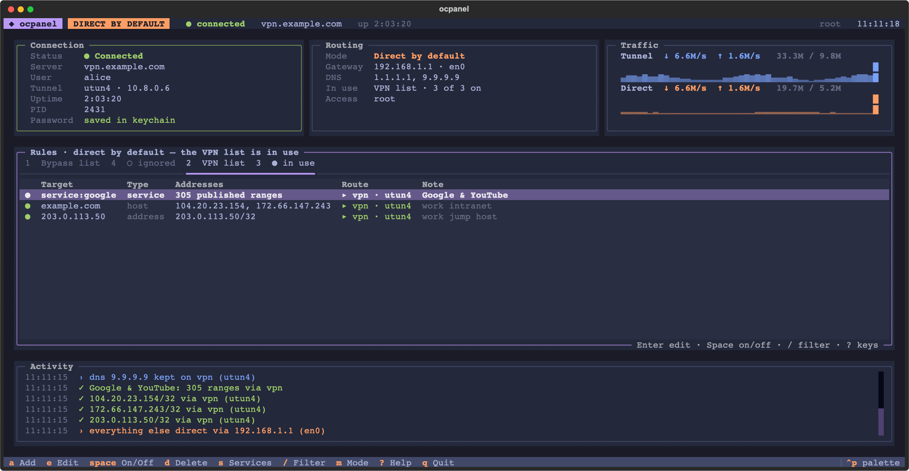
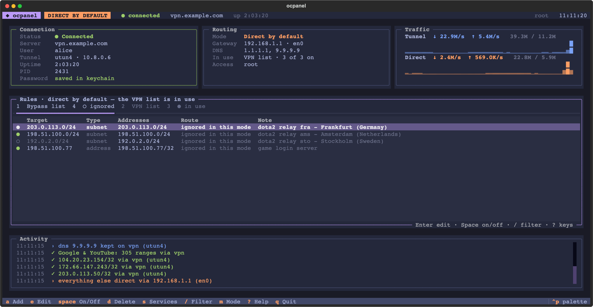
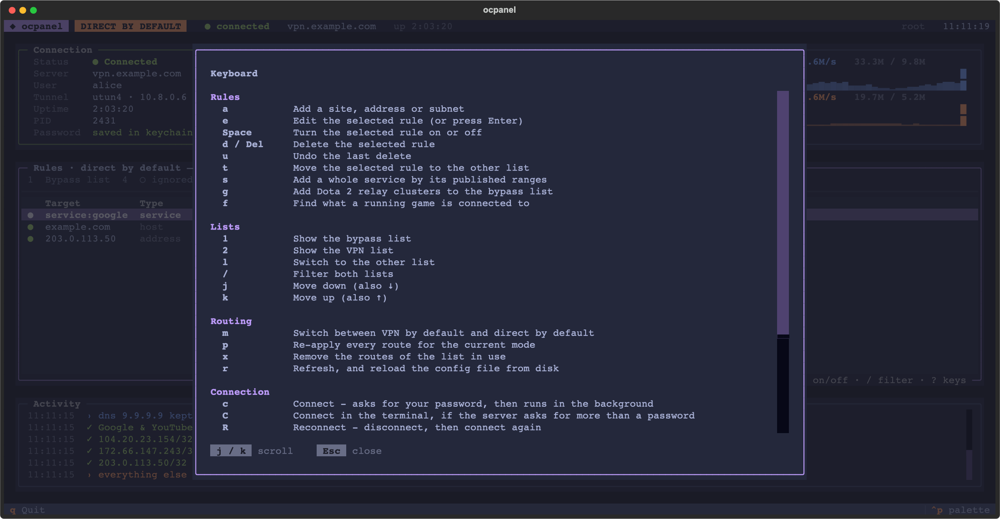

# ocpanel

**Split tunnelling on macOS — for OpenConnect and for system VPNs like V2Box — from the
client side, while the tunnel is running.**

[](#requirements)
[](#requirements)
[](https://textual.textualize.io/)
[](LICENSE)

A terminal panel for [OpenConnect](https://www.infradead.org/openconnect/) and for any VPN
that macOS runs as a system tunnel — V2Box, and other VLESS / VMess / Trojan / WireGuard
clients shipped as a NetworkExtension. Decide what goes through the tunnel and what goes
around it, watch it take effect, and connect or disconnect without leaving the panel.

ocpanel works on the **routing table**, not on the protocol, so it does not care who built
the tunnel. Your VPN server does not need to cooperate and does not need to know.



---

## Why

A VPN is all-or-nothing by default. Everything goes through the tunnel, including the
traffic that suffers most for it — a game that needs low latency, a download that does not
need hiding, a service that blocks VPN exit addresses.

Server-side split tunnelling (`ocserv`'s `no-route`) fixes that for everyone, if you run
the server. ocpanel does it on the client, for you, live, and shows you whether it actually
worked.

## Features

- **Works with whatever owns the tunnel.** openconnect, or a system VPN like V2Box. The
  panel shows which one is carrying your traffic and can stop or restart either.
- **Two directions, one keypress.** *VPN by default* with a bypass list, or *direct by
  default* with a VPN list. `m` switches; each mode keeps its own list.
- **It tells you the truth.** Every rule shows the interface the kernel *actually* uses for
  it right now — read back from the routing table, not assumed.
- **Whole services, not just hostnames.** A hostname becomes one or two addresses. `s` adds
  a service by the IP ranges its operator publishes (Google & YouTube: ~305 ranges).
- **Game-aware.** `g` pulls Valve's live Steam Datagram Relay list for Dota 2; `f` reads
  what a running game is connected to right now and offers to add it.
- **Connects in the background.** No frozen panel, no prompt you cannot see. The password
  can be remembered in your **login keychain** — never in a config file.
- **Survives a network change.** Routes point at a gateway, and macOS does not repoint them
  when you switch Wi-Fi. ocpanel does, while it is open — and ships an escape hatch for
  when it is not.
- **Keyboard first.** Every action has a key, dialogs answer to `y`/`n`, `?` lists
  everything and `Ctrl+P` searches it. The mouse still works.

## Requirements

| | |
|---|---|
| OS | macOS (11 or newer; uses BSD `route`, `netstat`, `scutil`, `security`) |
| VPN client | [`openconnect`](https://formulae.brew.sh/formula/openconnect) (`brew install openconnect`), **or** any client macOS registers as a system VPN (V2Box, WireGuard…) |
| Python | 3.10+ |
| Privileges | `sudo` to change routes. Without it the panel runs read-only. |

IPv4 only. See [Limitations](#limitations).

## Install

```bash
git clone https://github.com/A19M98A/ocpanel.git
cd ocpanel
./install.sh
```

`install.sh` creates its own virtualenv, installs [Textual](https://textual.textualize.io/),
and puts a launcher at `~/.local/bin/ocpanel`. It does not touch your system Python.

```bash
sudo ~/.local/bin/ocpanel
```

<details>
<summary>Prefer pip or pipx?</summary>

```bash
pipx install git+https://github.com/A19M98A/ocpanel.git
sudo "$(which ocpanel)"
```

Routing changes need root, so the binary has to be run with `sudo`. The config and the
keychain are still read as *you*, not as root.
</details>

## Quick start

1. `sudo ~/.local/bin/ocpanel`
2. Press **`c`** to connect. Fill in server, username and password; tick *Remember* to store
   the password in your login keychain.
3. Press **`a`** to add something to the list on screen, or **`s`** for a whole service.
4. Watch the **Route** column: green means the kernel is sending it where this mode wants
   it, red means it is not.
5. Press **`?`** for every key.

## What it can drive

| Owner of the tunnel | Shown as | `c` connect | `R` reconnect | `D` disconnect |
|---|---|---|---|---|
| `openconnect` | `openconnect` + pid | yes | yes | yes |
| System VPN (NetworkExtension) — V2Box, WireGuard… | e.g. `V2BOX (system VPN)` | start it in its own app | yes, via `scutil --nc` | yes |
| Anything else holding a `utun` default route | the interface name | no | no | no — but the routing still works |

For a system VPN the panel never needs your credentials: macOS starts and stops the
configuration by name, and the client handles its own protocol.

> **A proxy is not a tunnel.** If your client runs as a local SOCKS/HTTP proxy
> (`127.0.0.1:1080`) instead of a TUN interface, the routing table is not involved and
> ocpanel can do nothing for it. Use the client's own routing rules — V2Ray/Xray can match
> on domains (`geosite:google`), which is strictly more capable than IP routes.

## Two modes

Two separate lists, shown as tabs. Only one is ever applied; the other is kept and ignored.

| Mode | Default path | List in use |
|---|---|---|
| **VPN by default** | everything through the VPN | **bypass list** → goes direct |
| **Direct by default** | everything over your real connection | **VPN list** → goes through the VPN |



Press `m` to switch, `1`/`2` to look at either list. You can add to, edit and toggle the
list that is *not* in use at any time — changes are saved and take effect when you switch.

## How it works

**VPN by default.** OpenConnect installs a default route through `utun*`. For each target
on your bypass list, ocpanel adds a **more specific** route via your real gateway. A more
specific route always wins, so that traffic leaves over your normal connection and
everything else stays in the tunnel.

**Direct by default.** ocpanel adds `0.0.0.0/1` and `128.0.0.0/1` via your real gateway.
Together they cover every address and beat the VPN's `default` route without touching it —
switching back is just deleting those two. Targets on the VPN list get a route bound to the
tunnel interface, so they still go through it.

**DNS does not leak.** Before anything goes direct, resolvers reached through a router (a
public resolver such as `1.1.1.1`, as opposed to your own LAN router) are pinned to the
tunnel. Lookups keep being answered by the VPN's resolvers, so a hostname on your VPN list
cannot be resolved to something else by your ISP.

## Big services

A hostname rule resolves to the one or two addresses DNS returns at that moment. That is
fine for a small site and useless for YouTube: the page, the API (`youtubei.googleapis.com`),
thumbnails (`ytimg.com`) and the video itself (`googlevideo.com`) live on different
hostnames across hundreds of Google addresses, and DNS hands out different ones each time.

`s` adds the service by its published ranges, as a single row you can toggle or delete:

| Service | Source | Ranges |
|---|---|---|
| Google & YouTube | `gstatic.com/ipranges` (`goog.json` − `cloud.json`) | ~305 |

Google's list also contains Google **Cloud** customer ranges, which would drag unrelated
websites into your VPN. ocpanel subtracts them, as Google documents. If you add a hostname
that belongs to a known service, the panel warns you.

For Dota 2, `g` fetches Valve's live relay directory (65 clusters worldwide) and pre-ticks
the one you are using; `f` reads the running game's actual sockets.

## Keys



<details>
<summary>Full list</summary>

**Rules** — act on the list on screen

| Key | Action |
|---|---|
| `a` | add a site, address or subnet |
| `Enter` / `e` | edit the selected rule |
| `Space` | turn the selected rule on or off |
| `d` / `Del` | delete the selected rule |
| `u` | undo the last delete |
| `t` | move the selected rule to the other list |
| `s` | add a whole service by its published ranges |
| `g` | add Dota 2 relay clusters |
| `f` | find what a running game is connected to |

**Lists**

| Key | Action |
|---|---|
| `1` / `2` | bypass list / VPN list |
| `l` | switch to the other list |
| `/` | filter both lists |
| `j` `k` / arrows | move |

**Routing and connection**

| Key | Action |
|---|---|
| `m` | switch mode |
| `p` | re-apply every route for the current mode |
| `x` | remove the routes of the list in use |
| `r` | refresh, and reload the config from disk |
| `c` | connect with openconnect (in the background) |
| `C` | connect in the terminal — for a server that asks for 2FA, a group or a certificate |
| `R` | reconnect — openconnect, or restart a system VPN |
| `D` | disconnect whatever owns the tunnel |
| `F` | forget the saved password |
| `q` | quit |

**Dialogs**: `y`/`n` confirm or cancel (`Esc` cancels too) · `Enter` presses the highlighted
button, which is *Cancel* for anything destructive · `Tab` next field · in pick lists
`Space` ticks, `a` all, `n` none, `Enter` adds.

**Anywhere**: `?` help · `Ctrl+P` command palette (it also changes the theme; the choice is
remembered).
</details>

## The password

Tick **Remember it in my macOS login keychain** in the connect dialog. After a successful
connection the password is stored with `security` under the service `ocpanel-vpn`, and `c`
connects straight away from then on.

- It is **not** written to `config.json` — that file is plain text. The config only records
  `"save_password": true` so the panel knows to look.
- It is **not** passed on the command line, where `ps` would show it. openconnect reads it
  from stdin.
- It is **not** written to the activity log.
- The panel runs under `sudo`, so every keychain command is run back as you, not as root.

`F` forgets it again. Prefer your own secret store? Set `auth_command` (below).

## Safety and recovery

Routes point at a specific gateway, and **macOS does not remove or repoint them when you
change network**. ocpanel re-points them automatically while it is open. If you switch
Wi-Fi with the panel closed while direct mode is on, every connection breaks — so there is
an escape hatch that needs no UI:

```bash
sudo ~/.local/bin/ocpanel --reset
```

That removes the half-default routes and the DNS pins and returns to VPN-by-default. Your
rule lists are not touched.

Other guardrails:

- Quitting with a tunnel up asks: **`y`** disconnect and quit, **`l`** quit and leave the
  VPN running, **`n`** stay. In direct mode, disconnecting also tears down the half-default
  routes first, so they cannot be left pointing at a gateway that is about to be wrong.
- openconnect runs with `--non-inter`: it can never sit waiting at a prompt behind the
  panel. Failures are reported in openconnect's own words.
- An existing openconnect session started outside the panel is **adopted**, not restarted,
  and so is a system VPN you started from its own app.
- A tunnel the panel does not recognise is still shown, and the routing still works — it
  just will not offer to stop something it did not start.

## Configuration

`~/.config/ocpanel/config.json` — editable by hand; press `r` in the panel to reload it.

```jsonc
{
  "profile": {
    "server": "vpn.example.com",
    "user": "alice",
    "extra_args": ["--protocol=anyconnect"],  // passed straight to openconnect
    "auth_command": "",                       // a command that prints the password
    "save_password": true                     // the password itself is in the keychain
  },
  "mode": "vpn",                  // "vpn" or "direct"
  "theme": "tokyo-night",         // any Textual theme
  "disconnect_on_quit": true,     // false = q quits and leaves the VPN alone
  "rules":     [ { "target": "203.0.113.0/24", "note": "game relay", "enabled": true } ],
  "vpn_rules": [ { "target": "service:google", "note": "Google & YouTube", "enabled": true } ]
}
```

A `target` is a hostname, an IPv4 address, a subnet (`203.0.113.0/24`), or `service:<name>`.

| Path | What |
|---|---|
| `~/.config/ocpanel/config.json` | profile, mode, both rule lists |
| `~/.config/ocpanel/state.json` | which DNS pins ocpanel installed, so it removes exactly those |
| `~/.config/ocpanel/services/` | cached published ranges |
| `~/.config/ocpanel/sdr.json` | cached Valve relay directory |
| login keychain, `ocpanel-vpn` | the password, if you asked it to remember |

## Limitations

- **Routing is per destination, not per application.** The kernel does not know which app
  sent a packet, so two apps talking to the same address share its route. True per-app VPN
  routing on macOS needs a NetworkExtension; openconnect is not one.
- **IPv4 only.** IPv6 follows whatever the tunnel sets up.
- **macOS only.** It speaks to BSD `route`/`netstat`/`scutil` and the macOS keychain.
- **A tunnel is required.** Clients that only expose a local proxy port are out of scope
  (see above).
- Only services that publish their IP ranges can be added with `s`.

## Development

```bash
python3 -m venv venv && ./venv/bin/pip install textual
./check.sh                                            # syntax + stylesheet check
./venv/bin/python -m unittest discover -s tests -v    # unit tests (no root, no network)
```

| File | Role |
|---|---|
| `ocpanel/app.py` | state, routing decisions, actions |
| `ocpanel/ui.py` | screens, panels, and the keymap that drives keys, footer, help and palette |
| `ocpanel/netinfo.py` | reads the routing table, interfaces, live sockets |
| `ocpanel/rules.py` | a rule, and the `route` calls that install one |
| `ocpanel/vpn.py` | starting and stopping openconnect, and system VPNs via `scutil --nc` |
| `ocpanel/services.py`, `ocpanel/sdr.py` | published IP ranges; Valve's relay directory |
| `ocpanel/keychain.py` | the saved password |
| `ocpanel/app.tcss` | the stylesheet — every colour is a theme variable |

Adding a key is one line in `KEYMAP` (`ui.py`) plus an `action_*` method: the binding, the
footer entry, the help screen and the command palette all follow from it.

Anything that touches the routing table lives behind `rules.py`, so it can be stubbed —
the panel is exercised against a simulated routing table rather than a real one.

## License

MIT — see [LICENSE](LICENSE).
